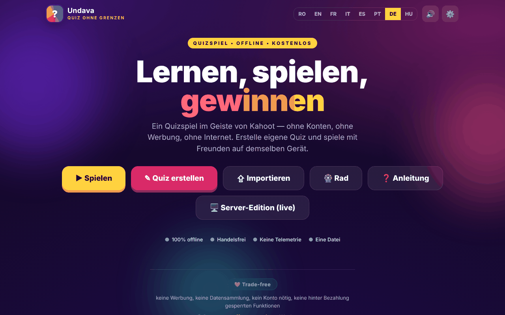

# Undava

[English](README.md) · [Română](README.ro.md) · [Français](README.fr.md) · [Italiano](README.it.md) · [Español](README.es.md) · [Português](README.pt.md) · **Deutsch** · [Magyar](README.hu.md)

**Version:** 2.2.0 · **Zuletzt aktualisiert:** 2026-10-27

**Status:** stabil · **Offline:** vollständig

Oberflächensprachen: **Română, English, Français, Italiano, Español, Português (PT), Deutsch, Magyar**

Ein Quizspiel im Geiste von Kahoot — „Quiz ohne Grenzen“, in einer einzigen HTML-Datei.

**Online:** https://chiuta.github.io/Undava/

## Was es ist

Undava ist ein Quizspiel: Du erstellst eigene Quizze und spielst allein oder mit Freunden auf demselben Gerät. Die App beschreibt sich als „offline, kostenlos, ohne Konten, ohne Werbung, ohne Telemetrie“. Die Oberfläche ist in 8 Sprachen verfügbar. Das Repository enthält außerdem `index.php`, eine Server-Edition (Dateispeicherung, ohne SQL-Datenbank), die im Dateikopf und im Handbuch der App beschrieben ist; die Seite auf GitHub Pages ist die statische Edition `index.html`.

## Funktionen

- **Spielen:** Quizbibliothek (mit Demo-Quizzen), Suche und Sortierung (Standard, Name A-Z, Anzahl Fragen), Spielmodi **Solo** und **Reihum** (mehrere Spieler auf demselben Gerät), Mischen von Fragen und Antworten, Rückblick auf die Antworten am Ende.
- **Persönlicher Rekord** pro Quiz (Solo-Modus): Das beste Ergebnis wird lokal gespeichert und erscheint auf der Quizkarte; am Ende erscheint „Neuer Rekord!“, wenn du ihn übertriffst, und die Schaltfläche **Fehler wiederholen** spielt nur die falsch beantworteten Fragen erneut (ohne den Rekord zu ändern).
- **Erstellen:** Quiz-Editor mit Titel und Beschreibung, vier Fragetypen — Multiple Choice (4 Antworten), Wahr / Falsch, Freie Antwort (mit akzeptierten Varianten), Numerisch (mit Toleranz) —, Standard- oder Doppelpunkte, Dauer pro Frage, Duplizieren von Fragen.
- **Importieren / Exportieren** von Quizzen als JSON-Dateien („Exportieren“, „Alle speichern“, „Importieren“), Drucken.
- **Glücksrad:** Zufallsauswahl aus Namen oder Optionen (Drehen, Mischen, Zurücksetzen, Option zum Entfernen des Gewinners).
- Anleitung in der App (Kurzanleitung, Benutzerhandbuch, Administratorhandbuch).
- Einstellungen: Sprache, Ton.
- Die Funktionen für synchrones Live-Spiel, das eigenständige Design und die Publikumsaktivitäten werden im Handbuch der App als Teil der Server-Edition (`index.php`) beschrieben, nicht der statischen Seite.
- Sprachen: Rumänisch, Englisch, Französisch, Italienisch, Spanisch, Portugiesisch, Deutsch, Ungarisch.

## Bedienungsanleitung

1. Öffne die Seite; wähle die Sprache in den Einstellungen oder über den Sprachumschalter.
2. Drücke **Quiz erstellen**, gib einen Titel ein, drücke „Frage hinzufügen“, wähle den Typ, schreibe die Antworten, hake „Richtig“ an und drücke „Quiz speichern“.
3. Drücke **Spielen**, wähle ein Quiz und einen Modus (**Solo** oder **Reihum**; im Modus Reihum fügst du die Spieler mit „+ Spieler hinzufügen“ hinzu), dann „Start“.
4. Bei Fragen mit Antwortoptionen kannst du per Klick/Tippen oder über die Tastatur antworten: `1`–`4` oder `Q`, `W`, `E`, `R`. Bei Fragen mit freier/numerischer Antwort schreibst du in das Feld „Antwort…“.
5. Am Ende kannst du den „Rückblick“ mit den richtigen Antworten sehen.
6. **Exportieren** speichert ein Quiz in einer JSON-Datei; „Alle speichern“ exportiert alle; **Importieren** lädt eine JSON-Datei (beim Import werden höchstens 50 Quizze aus einer Datei akzeptiert).
7. **Rad**: Schreibe ein Element pro Zeile, drücke „Drehen“.
8. Drücke **Anleitung** für das vollständige Handbuch.

## Datenschutz und Netzwerk

- **Lokaler Speicher:** `localStorage`, Schlüssel `undava.quiz_v1` (deine Quizze, Sprache, Toneinstellung usw.), `undava.quiz_v1_spin` (die Elemente des Rads) und `undava.quiz_v1_best` (die persönlichen Rekorde). Wenn du die Websitedaten löschst, gehen die lokalen Quizze verloren; nutze den JSON-Export.
- **Netzwerk:** Die Seite lädt keine Skripte, Schriftarten oder Bilder von anderen Websites (CSP: `default-src 'self'`, `connect-src 'self'`). Der einzige `fetch` im Code geht an `index.php?asset=manifest` derselben Website und wird verwendet, wenn du die „Server-Edition“ öffnest; auf einem statischen Host ohne PHP schlägt diese Prüfung fehl, und die App zeigt eine Installationsanleitung.
- Die Open-Graph-Metatags verweisen für die Link-Vorschau auf Bilder von `chiuta.github.io`; sie werden von den Plattformen gelesen, die den Link anzeigen, nicht von der App.
- Die Edition `index.php` (wenn du sie hostest) hat einen eigenen Server, ein Administratorpasswort und eine Feedback-Datei; sie ist nicht Teil der statischen Seite.
- Achtung bei der Edition `index.php`: Sie **speichert Daten auf dem Server** (Quizze, Besucher-Feedback in `data/feedback.txt`: optionaler Name, Bewertung, Nachricht, Quiz), daher gilt der Slogan „ohne Telemetrie“ für das, was die App an Dritte sendet, nicht für die Daten, die dein Server erhält. Das Feedback-Formular der Server-Edition zeigt (in den 8 Sprachen) einen Datenschutzhinweis: Die Daten werden auf dem Server der Instanz gespeichert und können vom Administrator eingesehen werden, die Löschung wird beim Administrator beantragt. Wenn du die Server-Edition öffentlich hostest, bist du Verantwortlicher für die Daten (DSGVO): informiere die Besucher, lösche auf Anfrage (die Löschschaltfläche im Feedback-Bildschirm oder die Datei `data/feedback.txt`) und bewahre Nachrichten nicht länger auf als nötig.
- **Installation der Server-Edition (Einrichtungsschlüssel):** „Der erste Besucher wird Administrator“ ist nicht mehr möglich. Das Anlegen des ersten Passworts erfordert einen *Einrichtungsschlüssel*, der nur auf dem Server existiert: die Datei `setup.key` neben `index.php` (oder `../undava-setup.key`, außerhalb des Web-Stammverzeichnisses, sicherer) mit mindestens 12 zufälligen Zeichen, oder die Umgebungsvariable `UNDAVA_SETUP_KEY`. Ohne Schlüssel wird die Einrichtung verweigert; eine `setup.key` im Anwendungsverzeichnis wird nach der Einrichtung automatisch gelöscht. Der Schlüssel wird im Fenster „Administrator-Einrichtung“ eingegeben. Falsche Versuche werden pro IP verlangsamt.

## Lokale Ausführung / offline

Lade `index.html` herunter und öffne sie im Browser; die statische Edition funktioniert ohne Internet. Die Server-Edition benötigt PHP 7.4+ und ein beschreibbares Verzeichnis `data`, gemäß dem Kopf von `index.php`.

## Lizenz

MIT — siehe Datei LICENSE

## Marken

Kahoot! ist eine Marke ihres Inhabers; Undava ist nicht mit Kahoot! verbunden, und der Name wird nur beschreibend verwendet („im Geiste von…“). Andere genannte Handelsnamen gehören ihren Inhabern.

## Autor

Alexio — Alexandru-Ionuț Chiuță, Kontakt: alexio@trom.tf

## Zusammenfassung

Undava („Quiz ohne Grenzen“) ist ein Quizspiel im Kahoot-Stil in einer HTML-Datei: Erstelle Quizze mit vier Fragetypen, spiele Solo oder reihum, importiere/exportiere JSON und nutze ein Zufallsrad. Oberfläche in 8 Sprachen. Die Quizze werden in localStorage gehalten; die statische Seite stellt keine Anfragen an Dritte. Eine separate PHP-Server-Edition (`index.php`) im Repository ergänzt die Funktionen, die einen Server benötigen.

## Audit

Audit: 2026-10-10 (Runde 2: 2026-10-11, Einrichtungsschlüssel für den ersten Administrator, DSGVO-Hinweis für Feedback, zugängliche Namen im Feedback-Formular) — im Browser geprüft (keine JS-Fehler, axe WCAG 2.1 AA auf allen Bildschirmen — Start, Bibliothek, Editor, Spiel, Rad, Anleitung, Import, Einstellungen — 0 Probleme der Stufe serious/critical nach Korrektur der Editor-Beschriftungen, des Kontrasts und des Inhaltsverzeichnisses der Anleitung); `index.php` besteht `php -l`, und dieselben Korrekturen sind auch in der PHP-Edition angewendet.

## Verlauf / Changelog

### 1.2.7 — 2026-10-23
- Robustheit: lokal gespeicherte, beschädigte Quizze (Null-Einträge, ohne Fragen, falsche Typen) werden beim Start mit denselben Regeln wie beim Import geprüft, statt die Bibliothek zu blockieren.

### 1.2.6 — 2026-10-23

- Die Schlüssel des lokalen Speichers verwenden jetzt das Präfix `undava.` (`FFF.store.migrate` beim Start, vor jedem Lesezugriff): vorhandene Daten bleiben automatisch erhalten, alte `.fff.json`-Sicherungen lassen sich weiterhin importieren.

### 1.2.4 — 2026-10-22
- fff-kit 1.1.4: Touch-Ziele und Mindestschriftgröße

### 1.2.3 — 2026-10-22
- fff-kit 1.1.2: PBKDF2 mit 600.000 Iterationen, Schutz vor Clickjacking.

### 1.2.2 — 2026-10-22
- Die nativen confirm()-Dialoge (Editor mit ungespeicherten Änderungen verlassen, Quiz löschen, Spiel verlassen) wurden durch einen barrierefreien Dialog in der aktuellen Sprache ersetzt.
- Genau ein H1: Die Druckansicht eines Quiz verwendet ein H2 mit gleichem Aussehen.
- Mobil: kein Text unter 12 px und Touch-Ziele von mindestens 24 px (WCAG 2.5.8).

- 1.1.0 — 2026-10-14: Datensicherung und Kennzeichnung von Daten (fff-kit).

- 1.0.1 — 2026-10-12: Die Version und das Datum der letzten Aktualisierung werden in der App angezeigt
- **11. Oktober 2026** (Runde 7) — `script-src` auf Basis eines SHA-256-Hashes statt `'unsafe-inline'`; das „Undava“-Logo (Start), die „← zurück“-Links und der Tonschalter lassen sich jetzt mit Tab erreichen und mit Eingabe/Leertaste aktivieren (vorher waren sie per Tastatur nicht zugänglich); Escape schließt modale Fenster; getestet (0 Fehler/CSP, axe 0 Verstöße bei 1280×800 und 360×740). `index.php` (die Server-Edition) wurde nicht geändert.
- **11. Oktober 2026** — persönliche Rekorde pro Quiz im Solo-Modus, Schaltfläche „Fehler wiederholen“ am Ende (Texte in den 7 Sprachen); im Browser getestet (0 JS-Fehler, axe-core 0 Verstöße bei 1280×800 und 360×740).
- **11. Oktober 2026** — Prüfrunde: im Browser erneut geprüft (keine JS-Fehler, axe-core 0 Verstöße bei 1280×800 und 360×740, kein horizontaler Überlauf); in `index.html` waren keine Codeänderungen nötig. Die App hat keine Versionsnummer.
