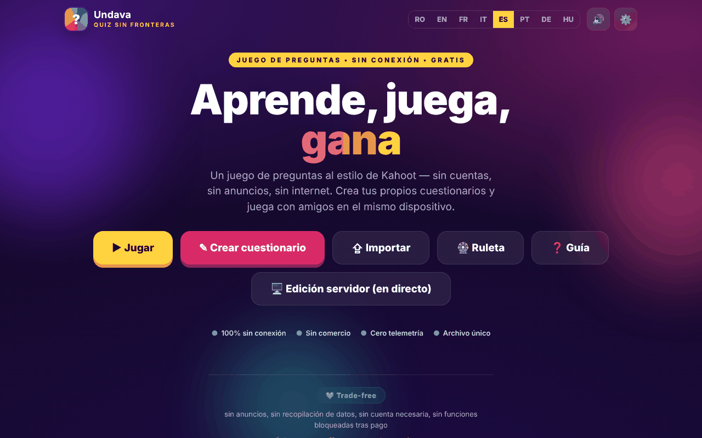

# Undava

[English](README.md) · [Română](README.ro.md) · [Français](README.fr.md) · [Italiano](README.it.md) · **Español** · [Português](README.pt.md) · [Deutsch](README.de.md) · [Magyar](README.hu.md)

**Versión:** 1.2.2 · **Última actualización:** 2026-10-22

Idiomas de la interfaz: **Română, English, Français, Italiano, Español, Português (PT), Deutsch, Magyar**

Un juego de preguntas y respuestas al estilo de Kahoot — «Quiz sin fronteras», en un único archivo HTML.

**En línea:** https://chiuta.github.io/Undava/

## Qué es

Undava es un juego de quiz: creas tus propios quizzes y juegas solo o con amigos en el mismo dispositivo. La aplicación se describe como «sin conexión, gratuita, sin cuentas, sin anuncios, sin telemetría». La interfaz está en 8 idiomas. El repositorio contiene también `index.php`, una edición de servidor (almacenamiento en archivos, sin base de datos SQL), descrita en la cabecera del archivo y en el manual de la aplicación; la página de GitHub Pages es la edición estática `index.html`.

## Funciones

- **Jugar:** biblioteca de quizzes (con quizzes de demostración), búsqueda y ordenación (Predeterminado, Nombre A-Z, N.º de preguntas), modos de juego **Solo** y **Por turnos** (varios jugadores en el mismo dispositivo), mezcla de preguntas y de opciones, repaso de las respuestas al final.
- **Récord personal** por quiz (modo Solo): la mejor puntuación se guarda localmente y aparece en la tarjeta del quiz; al final aparece «¡Nuevo récord!» cuando lo superas, y el botón **Repetir los fallos** vuelve a plantear solo las preguntas que fallaste (sin modificar el récord).
- **Crear:** editor de quizzes con título y descripción, cuatro tipos de preguntas — Opción múltiple (4 opciones), Verdadero / Falso, Respuesta libre (con variantes aceptadas), Numérica (con tolerancia) —, puntuación Estándar o Doble, duración por pregunta, duplicación de preguntas.
- **Importar / Exportar** quizzes como archivos JSON («Exportar», «Guardar todos», «Importar»), impresión.
- **Ruleta de la suerte:** selector aleatorio entre nombres u opciones (Girar, Mezclar, Restablecer, opción de eliminar al ganador).
- Guía de uso en la aplicación (Guía rápida, Manual de usuario, Manual de administrador).
- Ajustes: idioma, sonido.
- Las funciones de juego en directo síncrono, el tema autónomo y las actividades para la audiencia se describen en el manual de la aplicación como propias de la edición de servidor (`index.php`), no de la página estática.
- Idiomas: rumano, inglés, francés, italiano, español, portugués, alemán, húngaro.

## Manual de uso

1. Abre la página; elige el idioma en los ajustes o en el selector de idioma.
2. Pulsa **Crear quiz**, ponle un título, pulsa «Añadir pregunta», elige el tipo, escribe las respuestas, marca «Correcta» y pulsa «Guardar quiz».
3. Pulsa **Jugar**, elige un quiz y un modo (**Solo** o **Por turnos**; en el modo Por turnos añade los jugadores con «+ Añadir jugador»), y luego «Start».
4. En las preguntas con opciones puedes responder con clic/toque o con el teclado: `1`–`4` o `Q`, `W`, `E`, `R`. En las preguntas de respuesta libre/numérica escribes en el campo «Respuesta…».
5. Al final puedes ver el «Repaso» con las respuestas correctas.
6. **Exportar** guarda un quiz en un archivo JSON; «Guardar todos» los exporta todos; **Importar** carga un archivo JSON (al importar se aceptan como máximo 50 quizzes de un archivo).
7. **Ruleta**: escribe un elemento por línea, pulsa «Girar».
8. Pulsa **Guía** para el manual completo.

## Privacidad y red

- **Almacenamiento local:** `localStorage`, clave `quizfarafrontiere_v1` (tus quizzes, el idioma, el ajuste de sonido, etc.), `quizfarafrontiere_v1_spin` (los elementos de la Ruleta) y `quizfarafrontiere_v1_best` (los récords personales). Si borras los datos del sitio, los quizzes locales se pierden; usa la exportación JSON.
- **Red:** la página no carga scripts, fuentes ni imágenes de otros sitios (CSP: `default-src 'self'`, `connect-src 'self'`). El único `fetch` del código va a `index.php?asset=manifest` del mismo sitio, usado cuando abres la «edición de servidor»; en un host estático que no ejecuta PHP esta comprobación falla y la aplicación muestra una guía de instalación.
- Las metaetiquetas Open Graph apuntan a imágenes de `chiuta.github.io` para la vista previa del enlace; las leen las plataformas que muestran el enlace, no la aplicación.
- La edición `index.php` (si la alojas) tiene su propio servidor, contraseña de administrador y archivo de comentarios; no forma parte de la página estática.
- Atención a la edición `index.php`: **almacena datos en el servidor** (quizzes, comentarios de los visitantes en `data/feedback.txt`: nombre opcional, valoración, mensaje, quiz), por lo que el eslogan «sin telemetría» se aplica a lo que la aplicación envía a terceros, no a los datos que recibe tu servidor. El formulario de comentarios de la edición de servidor muestra (en los 8 idiomas) una nota de privacidad: los datos se conservan en el servidor de la instancia y puede leerlos el administrador, y la eliminación se solicita al administrador. Si alojas públicamente la edición de servidor eres el responsable del tratamiento de los datos (RGPD): informa a los visitantes, elimina a petición (el botón de eliminar de la pantalla de comentarios o el archivo `data/feedback.txt`) y no conserves los mensajes más tiempo del necesario.
- **Instalación de la edición de servidor (clave de instalación):** «el primer visitante se convierte en administrador» ya no es posible. Crear la primera contraseña exige una *clave de instalación* que existe solo en el servidor: el archivo `setup.key` junto a `index.php` (o `../undava-setup.key`, fuera de la raíz web, más seguro) con al menos 12 caracteres aleatorios, o la variable de entorno `UNDAVA_SETUP_KEY`. Sin clave, la configuración se rechaza; un `setup.key` en el directorio de la aplicación se elimina automáticamente tras la configuración. La clave se introduce en la ventana «Configuración del administrador». Los intentos erróneos se ralentizan por IP.

## Ejecución local / sin conexión

Descarga `index.html` y ábrelo en un navegador; la edición estática funciona sin internet. La edición de servidor necesita PHP 7.4+ y un directorio `data` con permiso de escritura, según la cabecera de `index.php`.

## Licencia

MIT — consulta el archivo LICENSE

## Marcas

Kahoot! es una marca de su titular; Undava no está afiliada a Kahoot! y el nombre se usa solo de forma descriptiva («al estilo de…»). Los demás nombres comerciales mencionados pertenecen a sus titulares.

## Autor

Alexio — Alexandru-Ionuț Chiuță, contacto: alexio@trom.tf

## Resumen

Undava («Quiz sin fronteras») es un juego de quiz al estilo de Kahoot en un único archivo HTML: crea quizzes con cuatro tipos de preguntas, juega en Solo o por turnos, importa/exporta JSON y usa una ruleta aleatoria. Interfaz en 8 idiomas. Los quizzes se guardan en localStorage; la página estática no hace solicitudes a terceros. Una edición de servidor PHP aparte (`index.php`) en el repositorio añade las funciones que necesitan un servidor.

## Auditoría

Auditoría: 2026-10-10 (ronda 2: 2026-10-11, clave de instalación para el administrador inicial, nota RGPD para los comentarios, nombres accesibles en el formulario de comentarios) — verificado en el navegador (sin errores de JS, axe WCAG 2.1 AA en todas las pantallas — inicio, biblioteca, editor, juego, ruleta, guía, importación, ajustes — 0 problemas serious/critical tras corregir las etiquetas del editor, el contraste y el índice de la guía); `index.php` pasa `php -l`, y las mismas correcciones se aplican también en la edición PHP.

## Historial / Changelog

### 1.2.2 — 2026-10-22
- Los cuadros confirm() nativos (salir del editor con cambios sin guardar, eliminar un cuestionario, abandonar una partida) se sustituyeron por un diálogo accesible en el idioma actual.
- Un solo H1: la vista de impresión de un cuestionario usa un H2 con el mismo aspecto.
- Móvil: ningún texto por debajo de 12 px y áreas táctiles de al menos 24 px (WCAG 2.5.8).

- 1.1.0 — 2026-10-14: copia de seguridad y etiquetado de datos (fff-kit).

- 1.0.1 — 2026-10-12: la versión y la fecha de la última actualización se muestran en la aplicación
- **11 de octubre de 2026** (ronda 7) — `script-src` basado en hash SHA-256 en lugar de `'unsafe-inline'`; el logotipo «Undava» (Inicio), los enlaces «← atrás» y el interruptor de sonido ahora se alcanzan con Tab y se activan con Intro/Espacio (antes no eran accesibles con el teclado); Escape cierra las ventanas modales; probado (0 errores/CSP, axe 0 infracciones a 1280×800 y 360×740). `index.php` (la edición de servidor) no se modificó.
- **11 de octubre de 2026** — récords personales por quiz en el modo Solo, botón «Repetir los fallos» al final (textos en los 7 idiomas); probado en el navegador (0 errores de JS, axe-core 0 infracciones a 1280×800 y 360×740).
- **11 de octubre de 2026** — ronda de verificación: reverificado en el navegador (sin errores de JS, axe-core 0 infracciones a 1280×800 y 360×740, sin desbordamiento horizontal); no fueron necesarios cambios de código en `index.html`. La aplicación no tiene número de versión.
