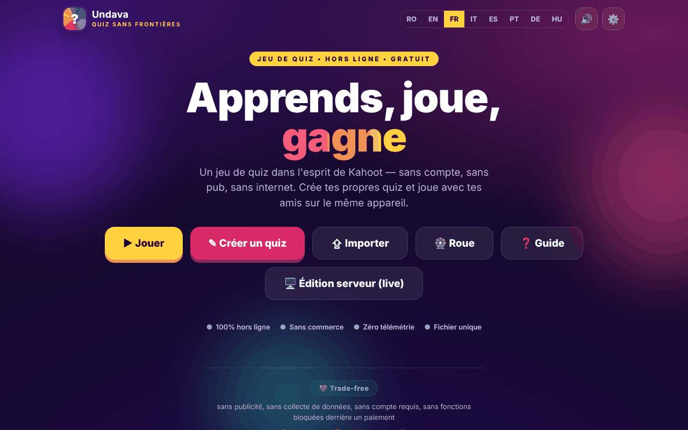

# Undava

[English](README.md) · [Română](README.ro.md) · **Français** · [Italiano](README.it.md) · [Español](README.es.md) · [Português](README.pt.md) · [Deutsch](README.de.md) · [Magyar](README.hu.md)

**Version :** 2.1.0 · **Dernière mise à jour :** 2026-10-27

**Statut:** stable · **Offline:** complet

Langues de l'interface : **Română, English, Français, Italiano, Español, Português (PT), Deutsch, Magyar**

Un jeu de quiz dans l'esprit de Kahoot — « Quiz sans frontières », dans un seul fichier HTML.

**En ligne :** https://chiuta.github.io/Undava/

## Ce que c'est

Undava est un jeu de quiz : vous créez vos propres quiz et jouez seul ou avec des amis sur le même appareil. L'application se décrit comme « hors ligne, gratuite, sans comptes, sans publicité, sans télémétrie ». L'interface est en 8 langues. Le dépôt contient aussi `index.php`, une édition serveur (stockage dans des fichiers, sans base de données SQL), décrite dans l'en-tête du fichier et dans le manuel de l'application ; la page sur GitHub Pages est l'édition statique `index.html`.

## Fonctionnalités

- **Jouer :** bibliothèque de quiz (avec des quiz de démonstration), recherche et tri (Par défaut, Nom A-Z, Nb de questions), modes de jeu **Solo** et **Chacun son tour** (plusieurs joueurs sur le même appareil), mélange des questions et des réponses, récapitulatif des réponses à la fin.
- **Record personnel** par quiz (mode Solo) : le meilleur score est enregistré localement et apparaît sur la carte du quiz ; à la fin, « Nouveau record ! » s'affiche quand vous le battez, et le bouton **Refaire les erreurs** ne rejoue que les questions où vous vous êtes trompé (sans modifier le record).
- **Créer :** éditeur de quiz avec titre et description, quatre types de questions — QCM (4 réponses), Vrai / Faux, Réponse libre (avec variantes acceptées), Numérique (avec tolérance) —, points Standard ou Double, durée par question, duplication des questions.
- **Importer / Exporter** des quiz sous forme de fichiers JSON (« Exporter », « Tout enregistrer », « Importer »), impression.
- **Roue de la fortune :** tirage au sort parmi des noms ou des options (Tourner, Mélanger, Réinitialiser, option d'élimination du gagnant).
- Guide d'utilisation dans l'application (Guide rapide, Manuel utilisateur, Manuel administrateur).
- Paramètres : langue, son.
- Les fonctions de jeu en direct synchrone, le thème autonome et les activités d'audience sont décrites dans le manuel de l'application comme relevant de l'édition serveur (`index.php`), et non de la page statique.
- Langues : roumain, anglais, français, italien, espagnol, portugais, allemand, hongrois.

## Mode d'emploi

1. Ouvrez la page ; choisissez la langue dans les paramètres ou avec le sélecteur de langue.
2. Appuyez sur **Créer un quiz**, donnez-lui un titre, appuyez sur « Ajouter une question », choisissez le type, écrivez les réponses, cochez « Correct » et appuyez sur « Enregistrer le quiz ».
3. Appuyez sur **Jouer**, choisissez un quiz et un mode (**Solo** ou **Chacun son tour** ; en mode Chacun son tour, ajoutez les joueurs avec « + Ajouter un joueur »), puis « Start ».
4. Pour les questions à choix, vous pouvez répondre par clic/toucher ou au clavier : `1`–`4` ou `Q`, `W`, `E`, `R`. Pour les questions à réponse libre/numérique, vous écrivez dans le champ « Réponse… ».
5. À la fin, vous pouvez voir le « Récapitulatif » avec les bonnes réponses.
6. **Exporter** enregistre un quiz dans un fichier JSON ; « Tout enregistrer » les exporte tous ; **Importer** charge un fichier JSON (à l'import, 50 quiz au maximum par fichier sont acceptés).
7. **Roue** : écrivez un élément par ligne, appuyez sur « Tourner ».
8. Appuyez sur **Guide** pour le manuel complet.

## Confidentialité et réseau

- **Stockage local :** `localStorage`, clé `undava.quiz_v1` (vos quiz, la langue, le réglage du son, etc.), `undava.quiz_v1_spin` (les éléments de la Roue) et `undava.quiz_v1_best` (les records personnels). Si vous effacez les données du site, les quiz locaux sont perdus ; utilisez l'export JSON.
- **Réseau :** la page ne charge ni scripts, ni polices, ni images depuis d'autres sites (CSP : `default-src 'self'`, `connect-src 'self'`). Le seul `fetch` du code vise `index.php?asset=manifest` sur le même site, utilisé lorsque vous ouvrez l'« édition serveur » ; sur un hébergement statique qui n'exécute pas PHP, cette vérification échoue et l'application affiche un guide d'installation.
- Les balises meta Open Graph pointent vers des images sur `chiuta.github.io` pour l'aperçu du lien ; elles sont lues par les plateformes qui affichent le lien, pas par l'application.
- L'édition `index.php` (si vous l'hébergez) a son propre serveur, son mot de passe administrateur et son fichier de retours ; elle ne fait pas partie de la page statique.
- Attention à l'édition `index.php` : elle **stocke des données sur le serveur** (quiz, retours des visiteurs dans `data/feedback.txt` : nom facultatif, note, message, quiz), de sorte que le slogan « sans télémétrie » s'applique à ce que l'application envoie à des tiers, et non aux données que reçoit votre serveur. Le formulaire de retours de l'édition serveur affiche (dans les 8 langues) une note de confidentialité : les données sont conservées sur le serveur de l'instance et peuvent être lues par l'administrateur, et la suppression se demande à l'administrateur. Si vous hébergez publiquement l'édition serveur, vous êtes l'opérateur des données (RGPD) : informez les visiteurs, supprimez sur demande (le bouton de suppression de l'écran de retours ou le fichier `data/feedback.txt`) et ne conservez pas les messages plus longtemps que nécessaire.
- **Installation de l'édition serveur (clé d'installation) :** « le premier visiteur devient administrateur » n'est plus possible. La création du premier mot de passe exige une *clé d'installation* qui n'existe que sur le serveur : un fichier `setup.key` à côté de `index.php` (ou `../undava-setup.key`, en dehors de la racine web, plus sûr) d'au moins 12 caractères aléatoires, ou la variable d'environnement `UNDAVA_SETUP_KEY`. Sans clé, la configuration est refusée ; un `setup.key` situé dans le répertoire de l'application est supprimé automatiquement après la configuration. La clé se saisit dans la fenêtre « Configuration de l'administrateur ». Les tentatives erronées sont ralenties par IP.

## Exécution locale / hors ligne

Téléchargez `index.html` et ouvrez-le dans un navigateur ; l'édition statique fonctionne sans internet. L'édition serveur nécessite PHP 7.4+ et un répertoire `data` accessible en écriture, conformément à l'en-tête de `index.php`.

## Licence

MIT — voir le fichier LICENSE

## Marques

Kahoot! est une marque de son titulaire ; Undava n'est pas affiliée à Kahoot! et le nom n'est utilisé que de manière descriptive (« dans l'esprit de… »). Les autres noms commerciaux mentionnés appartiennent à leurs titulaires.

## Auteur

Alexio — Alexandru-Ionuț Chiuță, contact : alexio@trom.tf

## Résumé

Undava (« Quiz sans frontières ») est un jeu de quiz de style Kahoot dans un seul fichier HTML : créez des quiz avec quatre types de questions, jouez en Solo ou à tour de rôle, importez/exportez du JSON et utilisez une roue aléatoire. Interface en 8 langues. Les quiz sont conservés dans localStorage ; la page statique n'effectue aucune requête vers des tiers. Une édition serveur PHP distincte (`index.php`) dans le dépôt ajoute les fonctions qui nécessitent un serveur.

## Audit

Audit : 2026-10-10 (tour 2 : 2026-10-11, clé d'installation pour l'administrateur initial, note RGPD pour les retours, noms accessibles dans le formulaire de retours) — vérifié dans le navigateur (aucune erreur JS, axe WCAG 2.1 AA sur tous les écrans — accueil, bibliothèque, éditeur, jeu, roue, guide, import, paramètres — 0 problème serious/critical après correction des étiquettes de l'éditeur, du contraste et de la table des matières du guide) ; `index.php` passe `php -l`, et les mêmes corrections sont appliquées aussi dans l'édition PHP.

## Historique / Changelog

### 1.2.7 — 2026-10-23
- Robustesse : les quiz enregistrés localement et corrompus (entrées nulles, sans questions, types erronés) sont validés au démarrage avec les mêmes règles qu'à l'import, au lieu de bloquer la bibliothèque.

### 1.2.6 — 2026-10-23

- Les clés du stockage local utilisent désormais le préfixe `undava.` (`FFF.store.migrate` au démarrage, avant toute lecture) : les données existantes sont conservées automatiquement et les anciennes sauvegardes `.fff.json` restent importables.

### 1.2.4 — 2026-10-22
- fff-kit 1.1.4 : cibles tactiles et taille de texte minimale

### 1.2.3 — 2026-10-22
- fff-kit 1.1.2 : PBKDF2 à 600 000 itérations, protection anti-clickjacking.

### 1.2.2 — 2026-10-22
- Les boîtes confirm() natives (quitter l'éditeur avec des modifications non enregistrées, supprimer un quiz, quitter une partie) sont remplacées par un dialogue accessible dans la langue courante.
- Un seul H1 : la vue d'impression d'un quiz utilise un H2 d'aspect identique.
- Mobile : aucun texte sous 12 px et cibles tactiles d'au moins 24 px (WCAG 2.5.8).

- 1.1.0 — 2026-10-14 : sauvegarde et étiquetage des données (fff-kit).

- 1.0.1 — 2026-10-12 : la version et la date de la dernière mise à jour sont affichées dans l'application
- **11 octobre 2026** (tour 7) — `script-src` par hachage SHA-256 à la place de `'unsafe-inline'` ; le logo « Undava » (Accueil), les liens « ← retour » et le commutateur de son peuvent désormais être atteints avec Tab et activés avec Entrée/Espace (auparavant ils n'étaient pas accessibles au clavier) ; Échap ferme les fenêtres modales ; testé (0 erreur/CSP, axe 0 violation à 1280×800 et 360×740). `index.php` (l'édition serveur) n'a pas été modifié.
- **11 octobre 2026** — records personnels par quiz en mode Solo, bouton « Refaire les erreurs » à la fin (textes dans les 7 langues) ; testé dans le navigateur (0 erreur JS, axe-core 0 violation à 1280×800 et 360×740).
- **11 octobre 2026** — tour de vérification : revérifié dans le navigateur (aucune erreur JS, axe-core 0 violation à 1280×800 et 360×740, pas de débordement horizontal) ; aucune modification de code n'a été nécessaire dans `index.html`. L'application n'a pas de numéro de version.
