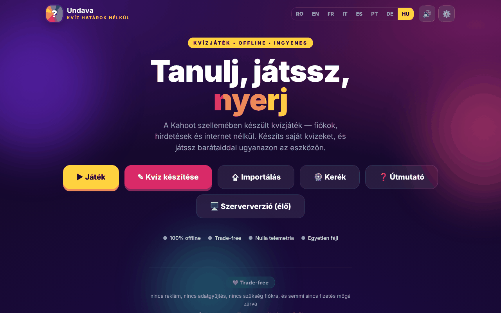

# Undava

[English](README.md) · [Română](README.ro.md) · [Français](README.fr.md) · [Italiano](README.it.md) · [Español](README.es.md) · [Português](README.pt.md) · [Deutsch](README.de.md) · **Magyar**

**Verzió:** 1.2.8 · **Utolsó frissítés:** 2026-10-26

A felület nyelvei: **Română, English, Français, Italiano, Español, Português (PT), Deutsch, Magyar**

Kahoot-szellemű kvízjáték — „Kvíz határok nélkül”, egyetlen HTML-fájlban.

**Élő verzió:** https://chiuta.github.io/Undava/

## Mi ez

Az Undava egy kvízjáték: saját kvízeket készíthetsz, és egyedül vagy barátokkal játszhatsz ugyanazon az eszközön. Az alkalmazás önmagát így írja le: „offline, ingyenes, fiókok nélkül, reklámok nélkül, telemetria nélkül”. A felület 8 nyelvű. A tároló tartalmazza az `index.php` fájlt is, amely egy szerveroldali kiadás (fájlalapú tárolás, SQL-adatbázis nélkül), amelyet a fájl fejléce és az alkalmazás kézikönyve ismertet; a GitHub Pages oldal a statikus `index.html` kiadás.

## Funkciók

- **Játék:** kvíztár (bemutató kvízekkel), keresés és rendezés (Alapértelmezett, Név A-Z, Kérdések száma), **Egyéni** és **Váltakozó** játékmódok (több játékos ugyanazon az eszközön), a kérdések és a válaszlehetőségek keverése, a válaszok áttekintése a végén.
- **Személyes rekord** kvízenként (Egyéni mód): a legjobb pontszám helyben mentődik, és megjelenik a kvíz kártyáján; a végén „Új rekord!” jelenik meg, ha túlszárnyalod, a **Hibák ismétlése** gomb pedig csak azokat a kérdéseket játssza újra, amelyeken hibáztál (a rekord módosítása nélkül).
- **Készítés:** kvízszerkesztő címmel és leírással, négy kérdéstípus — Feleletválasztós (4 válasz), Igaz / Hamis, Szabad válasz (elfogadott változatokkal), Numerikus (tűréssel) —, Normál vagy Dupla pontozás, kérdésenkénti időtartam, kérdések többszörözése.
- Kvízek **importálása / exportálása** JSON-fájlként („Exportálás”, „Összes mentése”, „Importálás”), nyomtatás.
- **Szerencsekerék:** véletlenszerű választó nevek vagy opciók közül (Pörgetés, Keverés, Visszaállítás, a nyertes eltávolításának lehetősége).
- Használati útmutató az alkalmazásban (Gyors útmutató, Felhasználói kézikönyv, Adminisztrátori kézikönyv).
- Beállítások: nyelv, hang.
- A szinkron élő játék, az önálló téma és a közönségtevékenységek funkcióit az alkalmazás kézikönyve a szerveroldali kiadáshoz (`index.php`) tartozóként írja le, nem a statikus oldalhoz.
- Nyelvek: román, angol, francia, olasz, spanyol, portugál, német, magyar.

## Használati útmutató

1. Nyisd meg az oldalt; válaszd ki a nyelvet a beállításokban vagy a nyelvváltóval.
2. Nyomd meg a **Kvíz készítése** gombot, adj címet, nyomd meg a „Kérdés hozzáadása” gombot, válaszd ki a típust, írd be a válaszokat, jelöld be a „Helyes” négyzetet, majd nyomd meg a „Kvíz mentése” gombot.
3. Nyomd meg a **Játék** gombot, válassz egy kvízt és egy módot (**Egyéni** vagy **Váltakozó**; Váltakozó módban add hozzá a játékosokat a „+ Játékos hozzáadása” gombbal), majd „Start”.
4. A válaszlehetőségekkel rendelkező kérdésekre kattintással/érintéssel vagy billentyűzetről válaszolhatsz: `1`–`4` vagy `Q`, `W`, `E`, `R`. A szabad/numerikus válaszú kérdéseknél a „Válasz…” mezőbe írsz.
5. A végén megtekintheted az „Áttekintést” a helyes válaszokkal.
6. Az **Exportálás** egy kvízt JSON-fájlba ment; az „Összes mentése” mindet exportálja; az **Importálás** betölt egy JSON-fájlt (importáláskor egy fájlból legfeljebb 50 kvíz fogadható el).
7. **Kerék**: írj be soronként egy elemet, nyomd meg a „Pörgetés” gombot.
8. A teljes kézikönyvért nyomd meg az **Útmutató** gombot.

## Adatvédelem és hálózat

- **Helyi tárolás:** `localStorage`, kulcs: `undava.quiz_v1` (a kvízeid, a nyelv, a hangbeállítás stb.), `undava.quiz_v1_spin` (a Kerék elemei) és `undava.quiz_v1_best` (a személyes rekordok). Ha törlöd az oldal adatait, a helyi kvízek elvesznek; használd a JSON-exportot.
- **Hálózat:** az oldal nem tölt be szkripteket, betűtípusokat vagy képeket más webhelyekről (CSP: `default-src 'self'`, `connect-src 'self'`). A kódban az egyetlen `fetch` ugyanazon webhely `index.php?asset=manifest` címére irányul, a „szerveroldali kiadás” megnyitásakor használva; PHP-t nem futtató statikus tárhelyen ez az ellenőrzés sikertelen, és az alkalmazás telepítési útmutatót jelenít meg.
- Az Open Graph metacímkék a `chiuta.github.io` képeire mutatnak a hivatkozás előnézetéhez; ezeket a hivatkozást megjelenítő platformok olvassák, nem az alkalmazás.
- Az `index.php` kiadásnak (ha te üzemelteted) saját szervere, adminisztrátori jelszava és visszajelzési fájlja van; nem része a statikus oldalnak.
- Figyelem az `index.php` kiadásnál: ez **adatokat tárol a szerveren** (kvízek, a látogatók visszajelzései a `data/feedback.txt` fájlban: opcionális név, értékelés, üzenet, kvíz), így a „telemetria nélkül” jelmondat arra vonatkozik, amit az alkalmazás harmadik feleknek küld, nem azokra az adatokra, amelyeket a te szervered fogad. A szerveroldali kiadás visszajelzési űrlapja (a 8 nyelven) adatvédelmi megjegyzést jelenít meg: az adatokat a példány szervere őrzi, és az adminisztrátor elolvashatja őket, a törlést az adminisztrátortól kell kérni. Ha nyilvánosan üzemelteted a szerveroldali kiadást, te vagy az adatkezelő (GDPR): tájékoztasd a látogatókat, kérésre töröld az adatokat (a visszajelzési képernyő törlés gombja vagy a `data/feedback.txt` fájl), és ne őrizd meg az üzeneteket a szükségesnél tovább.
- **A szerveroldali kiadás telepítése (telepítési kulcs):** az „első látogató lesz az adminisztrátor” már nem lehetséges. Az első jelszó létrehozásához *telepítési kulcs* kell, amely csak a szerveren létezik: egy `setup.key` fájl az `index.php` mellett (vagy a `../undava-setup.key`, a webgyökéren kívül, biztonságosabb) legalább 12 véletlen karakterrel, vagy az `UNDAVA_SETUP_KEY` környezeti változó. Kulcs nélkül a beállítást elutasítja; az alkalmazás könyvtárában lévő `setup.key` a beállítás után automatikusan törlődik. A kulcsot az „Adminisztrátor beállítása” ablakban kell megadni. A hibás próbálkozásokat IP-címenként lassítja.

## Helyi futtatás / offline

Töltsd le az `index.html` fájlt, és nyisd meg böngészőben; a statikus kiadás internet nélkül működik. A szerveroldali kiadáshoz PHP 7.4+ és írható `data` könyvtár szükséges, az `index.php` fejléce szerint.

## Licenc

MIT — lásd a LICENSE fájlt

## Védjegyek

A Kahoot! tulajdonosának védjegye; az Undava nem áll kapcsolatban a Kahoot!-tal, a nevet csak leíró jelleggel használjuk („…szellemében”). Az említett egyéb kereskedelmi nevek tulajdonosaikat illetik.

## Szerző

Alexio — Alexandru-Ionuț Chiuță, kapcsolat: alexio@trom.tf

## Összefoglaló

Az Undava („Kvíz határok nélkül”) egy Kahoot-stílusú kvízjáték egyetlen HTML-fájlban: készíts kvízeket négy kérdéstípussal, játssz Egyénileg vagy váltakozva, importálj/exportálj JSON-t, és használj véletlenszerű kereket. 8 nyelvű felület. A kvízek a localStorage-ban maradnak; a statikus oldal nem kezdeményez harmadik feleknek szóló kéréseket. A tárolóban egy különálló PHP szerveroldali kiadás (`index.php`) hozzáadja a szervert igénylő funkciókat.

## Audit

Audit: 2026-10-10 (2. kör: 2026-10-11, telepítési kulcs a kezdeti adminisztrátorhoz, GDPR-megjegyzés a visszajelzésekhez, elérhető nevek a visszajelzési űrlapon) — böngészőben ellenőrizve (nincs JS-hiba, axe WCAG 2.1 AA minden képernyőn — kezdőlap, kvíztár, szerkesztő, játék, kerék, útmutató, importálás, beállítások — 0 serious/critical probléma a szerkesztő címkéinek, a kontrasztnak és az útmutató tartalomjegyzékének javítása után); az `index.php` átmegy a `php -l` ellenőrzésen, és ugyanezek a javítások a PHP-kiadásban is alkalmazva vannak.

## Előzmények / Changelog

### 1.2.7 — 2026-10-23
- Robusztusság: a helyben mentett, sérült kvízek (null elemek, kérdés nélküliek, rossz típusok) induláskor ugyanazokkal a szabályokkal ellenőrzöttek, mint importáláskor, ahelyett hogy megakasztanák a könyvtárat.

### 1.2.6 — 2026-10-23

- A helyi tárhely kulcsai mostantól a `undava.` előtagot használják (`FFF.store.migrate` induláskor, bármilyen olvasás előtt): a meglévő adatok automatikusan megmaradnak, a régi `.fff.json` mentések továbbra is importálhatók.

### 1.2.4 — 2026-10-22
- fff-kit 1.1.4: érintési célpontok és minimális szövegméret

### 1.2.3 — 2026-10-22
- fff-kit 1.1.2: PBKDF2 600 000 iterációval, clickjacking elleni védelem.

### 1.2.2 — 2026-10-22
- A natív confirm() ablakokat (kilépés a szerkesztőből mentetlen módosításokkal, kvíz törlése, játék elhagyása) akadálymentes, az aktuális nyelvű párbeszédablak váltotta fel.
- Pontosan egy H1: a kvíz nyomtatási nézete azonos kinézetű H2-t használ.
- Mobil: nincs 12 px alatti szöveg, az érintési célpontok legalább 24 px-esek (WCAG 2.5.8).

- 1.1.0 — 2026-10-14: adatmentés és adatcímkézés (fff-kit).

- 1.0.1 — 2026-10-12: a verzió és az utolsó frissítés dátuma megjelenik az alkalmazásban
- **2026. október 11.** (7. kör) — SHA-256 hash alapú `script-src` az `'unsafe-inline'` helyett; az „Undava” embléma (Kezdőlap), a „← vissza” hivatkozások és a hangkapcsoló mostantól Tab billentyűvel elérhető és Enterrel/Szóközzel aktiválható (korábban billentyűzettel nem voltak elérhetők); az Escape bezárja a modális ablakokat; tesztelve (0 hiba/CSP, axe 0 szabálysértés 1280×800 és 360×740 mellett). Az `index.php` (a szerveroldali kiadás) nem lett módosítva.
- **2026. október 11.** — személyes rekordok kvízenként Egyéni módban, „Hibák ismétlése” gomb a végén (szövegek a 7 nyelven); böngészőben tesztelve (0 JS-hiba, axe-core 0 szabálysértés 1280×800 és 360×740 mellett).
- **2026. október 11.** — ellenőrző kör: böngészőben újra ellenőrizve (nincs JS-hiba, axe-core 0 szabálysértés 1280×800 és 360×740 mellett, nincs vízszintes túlcsordulás); az `index.html` fájlban nem volt szükség kódmódosításra. Az alkalmazásnak nincs verziószáma.
