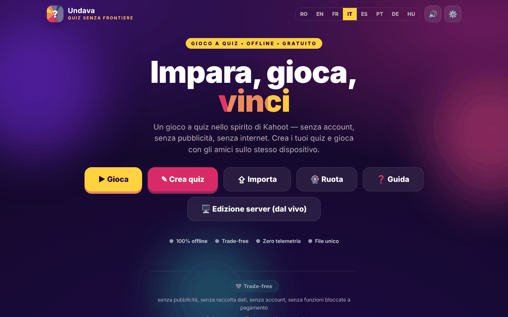

# Undava

[English](README.md) · [Română](README.ro.md) · [Français](README.fr.md) · **Italiano** · [Español](README.es.md) · [Português](README.pt.md) · [Deutsch](README.de.md) · [Magyar](README.hu.md)

**Versione:** 1.2.5 · **Ultimo aggiornamento:** 2026-10-23

Lingue dell'interfaccia: **Română, English, Français, Italiano, Español, Português (PT), Deutsch, Magyar**

Un gioco a quiz nello spirito di Kahoot — «Quiz senza frontiere», in un unico file HTML.

**Online:** https://chiuta.github.io/Undava/

## Che cos'è

Undava è un gioco a quiz: crei i tuoi quiz e giochi da solo o con gli amici sullo stesso dispositivo. L'app si descrive come «offline, gratuita, senza account, senza pubblicità, senza telemetria». L'interfaccia è in 8 lingue. Il repository contiene anche `index.php`, un'edizione server (archiviazione su file, senza database SQL), descritta nell'intestazione del file e nel manuale dell'app; la pagina su GitHub Pages è l'edizione statica `index.html`.

## Funzioni

- **Gioca:** libreria di quiz (con quiz dimostrativi), ricerca e ordinamento (Predefinito, Nome A-Z, N. di domande), modalità di gioco **Solo** e **A turno** (più giocatori sullo stesso dispositivo), mescolamento di domande e risposte, riepilogo delle risposte alla fine.
- **Record personale** per quiz (modalità Solo): il miglior punteggio viene salvato localmente e compare sulla scheda del quiz; alla fine compare «Nuovo record!» quando lo superi, e il pulsante **Ripeti gli errori** ripropone solo le domande sbagliate (senza modificare il record).
- **Crea:** editor di quiz con titolo e descrizione, quattro tipi di domande — Scelta multipla (4 opzioni), Vero / Falso, Risposta libera (con varianti accettate), Numerica (con tolleranza) —, punteggio Standard o Doppio, durata per domanda, duplicazione delle domande.
- **Importa / Esporta** quiz come file JSON («Esporta», «Salva tutti», «Importa»), stampa.
- **Ruota della fortuna:** selettore casuale tra nomi o opzioni (Gira, Mescola, Azzera, opzione di eliminazione del vincitore).
- Guida all'uso nell'app (Guida rapida, Manuale utente, Manuale amministratore).
- Impostazioni: lingua, audio.
- Le funzioni di gioco dal vivo sincrono, il tema autonomo e le attività per il pubblico sono descritte nel manuale dell'app come appartenenti all'edizione server (`index.php`), non alla pagina statica.
- Lingue: rumeno, inglese, francese, italiano, spagnolo, portoghese, tedesco, ungherese.

## Manuale d'uso

1. Apri la pagina; scegli la lingua dalle impostazioni o dal selettore di lingua.
2. Premi **Crea quiz**, dagli un titolo, premi «Aggiungi domanda», scegli il tipo, scrivi le risposte, spunta «Corretta» e premi «Salva quiz».
3. Premi **Gioca**, scegli un quiz e una modalità (**Solo** o **A turno**; in modalità A turno aggiungi i giocatori con «+ Aggiungi giocatore»), poi «Start».
4. Nelle domande con opzioni puoi rispondere con clic/tocco o da tastiera: `1`–`4` oppure `Q`, `W`, `E`, `R`. Nelle domande a risposta libera/numerica scrivi nel campo «Risposta…».
5. Alla fine puoi vedere il «Riepilogo» con le risposte corrette.
6. **Esporta** salva un quiz in un file JSON; «Salva tutti» li esporta tutti; **Importa** carica un file JSON (all'importazione sono accettati al massimo 50 quiz da un file).
7. **Ruota**: scrivi un elemento per riga, premi «Gira».
8. Premi **Guida** per il manuale completo.

## Privacy e rete

- **Memorizzazione locale:** `localStorage`, chiave `quizfarafrontiere_v1` (i tuoi quiz, la lingua, l'impostazione audio ecc.), `quizfarafrontiere_v1_spin` (gli elementi della Ruota) e `quizfarafrontiere_v1_best` (i record personali). Se cancelli i dati del sito, i quiz locali vanno persi; usa l'esportazione JSON.
- **Rete:** la pagina non carica script, font o immagini da altri siti (CSP: `default-src 'self'`, `connect-src 'self'`). L'unico `fetch` nel codice è verso `index.php?asset=manifest` sullo stesso sito, usato quando apri l'«edizione server»; su un host statico che non esegue PHP questo controllo fallisce e l'app mostra una guida all'installazione.
- I meta tag Open Graph puntano a immagini su `chiuta.github.io` per l'anteprima del link; sono letti dalle piattaforme che mostrano il link, non dall'app.
- L'edizione `index.php` (se la ospiti) ha un proprio server, una password di amministratore e un file di feedback; non fa parte della pagina statica.
- Attenzione all'edizione `index.php`: essa **memorizza dati sul server** (quiz, feedback dei visitatori in `data/feedback.txt`: nome facoltativo, voto, messaggio, quiz), quindi lo slogan «senza telemetria» si applica a ciò che l'app invia a terzi, non ai dati che riceve il tuo server. Il modulo di feedback dell'edizione server mostra (nelle 8 lingue) una nota sulla privacy: i dati sono conservati sul server dell'istanza e possono essere letti dall'amministratore, e la cancellazione si richiede all'amministratore. Se ospiti pubblicamente l'edizione server sei il titolare del trattamento dei dati (GDPR): informa i visitatori, cancella su richiesta (il pulsante di cancellazione nella schermata di feedback o il file `data/feedback.txt`) e non conservare i messaggi più a lungo del necessario.
- **Installazione dell'edizione server (chiave di installazione):** «il primo visitatore diventa amministratore» non è più possibile. La creazione della prima password richiede una *chiave di installazione* che esiste solo sul server: il file `setup.key` accanto a `index.php` (o `../undava-setup.key`, fuori dalla radice web, più sicuro) con almeno 12 caratteri casuali, oppure la variabile d'ambiente `UNDAVA_SETUP_KEY`. Senza chiave, la configurazione viene rifiutata; un `setup.key` nella directory dell'applicazione viene eliminato automaticamente dopo la configurazione. La chiave si inserisce nella finestra «Configurazione amministratore». I tentativi errati vengono rallentati per IP.

## Esecuzione in locale / offline

Scarica `index.html` e aprilo nel browser; l'edizione statica funziona senza internet. Per l'edizione server servono PHP 7.4+ e una directory `data` scrivibile, secondo l'intestazione di `index.php`.

## Licenza

MIT — vedi il file LICENSE

## Marchi

Kahoot! è un marchio del suo titolare; Undava non è affiliata a Kahoot! e il nome è usato solo in modo descrittivo («nello spirito di…»). Gli altri nomi commerciali citati appartengono ai rispettivi titolari.

## Autore

Alexio — Alexandru-Ionuț Chiuță, contatto: alexio@trom.tf

## Riepilogo

Undava («Quiz senza frontiere») è un gioco a quiz in stile Kahoot in un unico file HTML: crea quiz con quattro tipi di domande, gioca in Solo o a turno, importa/esporta JSON e usa una ruota casuale. Interfaccia in 8 lingue. I quiz sono conservati in localStorage; la pagina statica non effettua richieste a terzi. Un'edizione server PHP separata (`index.php`) nel repository aggiunge le funzioni che richiedono un server.

## Audit

Audit: 2026-10-10 (round 2: 2026-10-11, chiave di installazione per l'amministratore iniziale, nota GDPR per il feedback, nomi accessibili nel modulo di feedback) — verificato nel browser (nessun errore JS, axe WCAG 2.1 AA su tutte le schermate — home, libreria, editor, gioco, ruota, guida, importazione, impostazioni — 0 problemi serious/critical dopo la correzione delle etichette dell'editor, del contrasto e dell'indice della guida); `index.php` supera `php -l`, e le stesse correzioni sono applicate anche nell'edizione PHP.

## Cronologia / Changelog

### 1.2.4 — 2026-10-22
- fff-kit 1.1.4: bersagli touch e testo minimo

### 1.2.3 — 2026-10-22
- fff-kit 1.1.2: PBKDF2 a 600.000 iterazioni, protezione anti-clickjacking.

### 1.2.2 — 2026-10-22
- Le finestre confirm() native (uscire dall'editor con modifiche non salvate, eliminare un quiz, lasciare una partita) sono state sostituite da una finestra accessibile nella lingua corrente.
- Un solo H1: la vista di stampa di un quiz usa un H2 con lo stesso aspetto.
- Mobile: nessun testo sotto i 12 px e aree tattili di almeno 24 px (WCAG 2.5.8).

- 1.1.0 — 2026-10-14: backup ed etichettatura dei dati (fff-kit).

- 1.0.1 — 2026-10-12: la versione e la data dell'ultimo aggiornamento sono mostrate nell'app
- **11 ottobre 2026** (round 7) — `script-src` basato su hash SHA-256 al posto di `'unsafe-inline'`; il logo «Undava» (Home), i link «← indietro» e l'interruttore audio ora si raggiungono con Tab e si attivano con Invio/Spazio (prima non erano accessibili da tastiera); Esc chiude le finestre modali; testato (0 errori/CSP, axe 0 violazioni a 1280×800 e 360×740). `index.php` (l'edizione server) non è stato modificato.
- **11 ottobre 2026** — record personali per quiz in modalità Solo, pulsante «Ripeti gli errori» alla fine (testi nelle 7 lingue); testato nel browser (0 errori JS, axe-core 0 violazioni a 1280×800 e 360×740).
- **11 ottobre 2026** — round di verifica: riverificato nel browser (nessun errore JS, axe-core 0 violazioni a 1280×800 e 360×740, nessun overflow orizzontale); non sono state necessarie modifiche al codice in `index.html`. L'app non ha un numero di versione.
