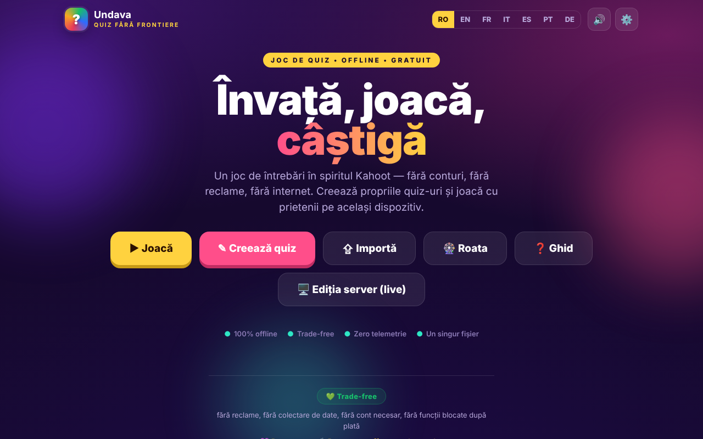

# Undava

Joc de quiz în spiritul Kahoot — „Quiz fără frontiere”, într-un singur fișier HTML.

**Ultima actualizare:** 11 octombrie 2026

**Live:** https://chiuta.github.io/Undava/

## Ce este

Undava este un joc de quiz: creezi propriile quiz-uri și joci singur sau cu prietenii pe același dispozitiv. Aplicația se descrie ca „offline, gratuit, fără conturi, fără reclame, fără telemetrie”. Interfața este în 7 limbi. Repository-ul conține și `index.php`, o ediție server (stocare în fișiere, fără bază de date SQL), descrisă în antetul fișierului și în manualul din aplicație; pagina de pe GitHub Pages este ediția statică `index.html`.

## Funcții

- **Joacă:** bibliotecă de quiz-uri (cu quiz-uri demonstrative), căutare și sortare (Implicit, Nume A-Z, Nr. întrebări), moduri de joc **Solo** și **Pe rând** (mai mulți jucători pe același dispozitiv), amestecarea întrebărilor și a variantelor, recapitulare a răspunsurilor la final.
- **Creează:** editor de quiz cu titlu și descriere, patru tipuri de întrebări — Grilă (4 variante), Adevărat / Fals, Răspuns liber (cu variante acceptate), Numeric (cu toleranță) —, punctaj Standard sau Dublu, durată per întrebare, duplicarea întrebărilor.
- **Importă / Exportă** quiz-uri ca fișiere JSON („Exportă”, „Salvează toate”, „Importă”), printare.
- **Roata norocului:** selector aleatoriu din nume sau opțiuni (Învârte, Amestecă, Resetează, opțiunea de eliminare a câștigătorului).
- Ghid de utilizare în aplicație (Ghid simplu, Manual utilizator, Manual administrator).
- Setări: limbă, sunet.
- Funcțiile de joc live sincron, tema autonomă și activitățile de audiență sunt descrise în manualul din aplicație ca aparținând ediției server (`index.php`), nu paginii statice.
- Limbi: română, engleză, franceză, italiană, spaniolă, portugheză, germană.

## Manual de utilizare

1. Deschide pagina; alege limba din setări sau din comutatorul de limbă.
2. Apasă **Creează quiz**, dă un titlu, apasă „Adaugă întrebare”, alege tipul, scrie răspunsurile, bifează „Corect” și apasă „Salvează quiz-ul”.
3. Apasă **Joacă**, alege un quiz și un mod (**Solo** sau **Pe rând**; în modul Pe rând adaugă jucătorii cu „+ Adaugă jucător”), apoi „Start”.
4. La întrebări cu variante poți răspunde cu click/atingere sau de la tastatură: `1`–`4` sau `Q`, `W`, `E`, `R`. La întrebările cu răspuns liber/numeric scrii în câmpul „Răspuns…”.
5. La final poți vedea „Recapitulare” cu răspunsurile corecte.
6. **Exportă** salvează un quiz în fișier JSON; „Salvează toate” le exportă pe toate; **Importă** încarcă un fișier JSON (la import sunt acceptate cel mult 50 de quiz-uri dintr-un fișier).
7. **Roata**: scrie câte un element pe linie, apasă „Învârte”.
8. Apasă **Ghid** pentru manualul complet.

## Confidențialitate și rețea

- **Stocare locală:** `localStorage`, cheia `quizfarafrontiere_v1` (quiz-urile tale, limba, setarea de sunet etc.) și `quizfarafrontiere_v1_spin` (elementele Roții). Dacă ștergi datele site-ului, quiz-urile locale se pierd; folosește exportul JSON.
- **Rețea:** pagina nu încarcă scripturi, fonturi sau imagini de pe alte site-uri (CSP: `default-src 'self'`, `connect-src 'self'`). Singurul `fetch` din cod este către `index.php?asset=manifest` de pe același site, folosit când deschizi „ediția server”; pe un host static care nu rulează PHP această verificare eșuează și aplicația afișează un ghid de instalare.
- Metaetichetele Open Graph indică imagini de pe `chiuta.github.io` pentru previzualizarea linkului; ele sunt citite de platformele care afișează linkul, nu de aplicație.
- Ediția `index.php` (dacă o găzduiești) are propriul server, parolă de administrator și fișier de feedback; ea nu face parte din pagina statică.
- Atenție la ediția `index.php`: ea **stochează date pe server** (quiz-uri, feedback-ul vizitatorilor în `data/feedback.txt`: nume opțional, notă, mesaj, quiz), deci sloganul „fără telemetrie” se aplică la ce trimite aplicația către terți, nu la datele pe care serverul tău le primește. Formularul de feedback din ediția server afișează (în cele 7 limbi) o notă de confidențialitate: datele sunt păstrate pe serverul instanței și pot fi citite de administrator, iar ștergerea se cere administratorului. Dacă găzduiești public ediția server ești operatorul datelor (GDPR): informează vizitatorii, șterge la cerere (butonul de ștergere din ecranul de feedback sau fișierul `data/feedback.txt`) și nu păstra mesajele mai mult decât este necesar.
- **Instalarea ediției server (cheie de instalare):** „primul vizitator devine administrator” nu mai este posibil. Crearea primei parole cere o *cheie de instalare* care există doar pe server: fișierul `setup.key` lângă `index.php` (sau `../undava-setup.key`, în afara rădăcinii web, mai sigur) cu cel puțin 12 caractere aleatorii, ori variabila de mediu `UNDAVA_SETUP_KEY`. Fără cheie, configurarea este refuzată; un `setup.key` din directorul aplicației este șters automat după configurare. Cheia se introduce în fereastra „Configurare administrator”. Încercările greșite sunt încetinite pe IP.

## Rulare locală / offline

Descarcă `index.html` și deschide-l în browser; ediția statică funcționează fără internet. Pentru ediția server este nevoie de PHP 7.4+ și de un director `data` scriptibil, conform antetului din `index.php`.

## Licență

CC0 1.0 Universal (domeniu public) — vezi fișierul LICENSE

## Mărci

Kahoot! este o marcă a deținătorului ei; Undava nu este afiliată cu Kahoot! și numele este folosit doar descriptiv („în spiritul…”). Alte nume comerciale menționate aparțin deținătorilor lor.

## Autor

Alexio — Alexandru-Ionuț Chiuță, contact: alexio@trom.tf

## English summary

Undava ("Quiz without borders") is a Kahoot-style quiz game in one HTML file: create quizzes with four question types, play Solo or pass-and-play, import/export JSON, and use a random wheel. 7-language UI. Quizzes are kept in localStorage; the static page makes no third-party requests. A separate PHP server edition (`index.php`) in the repo adds the features that need a server.

## Audit

Audit: 2026-10-10 (rundă 2: 2026-10-11, cheie de instalare pentru administratorul inițial, notă GDPR pentru feedback, nume accesibile în formularul de feedback) — verificat în browser (fără erori JS, axe WCAG 2.1 AA pe toate ecranele — acasă, bibliotecă, editor, joc, roată, ghid, import, setări — 0 probleme serious/critical după corectarea etichetelor din editor, a contrastului și a cuprinsului ghidului); `index.php` trece `php -l`, iar aceleași corecturi sunt aplicate și în ediția PHP.

## Istoric / Changelog

- **11 octombrie 2026** — rundă de verificare: reverificat în browser (fără erori JS, axe-core 0 violări la 1280×800 și 360×740, fără depășire orizontală); nu au fost necesare modificări de cod în `index.html`. Aplicația nu are număr de versiune.
