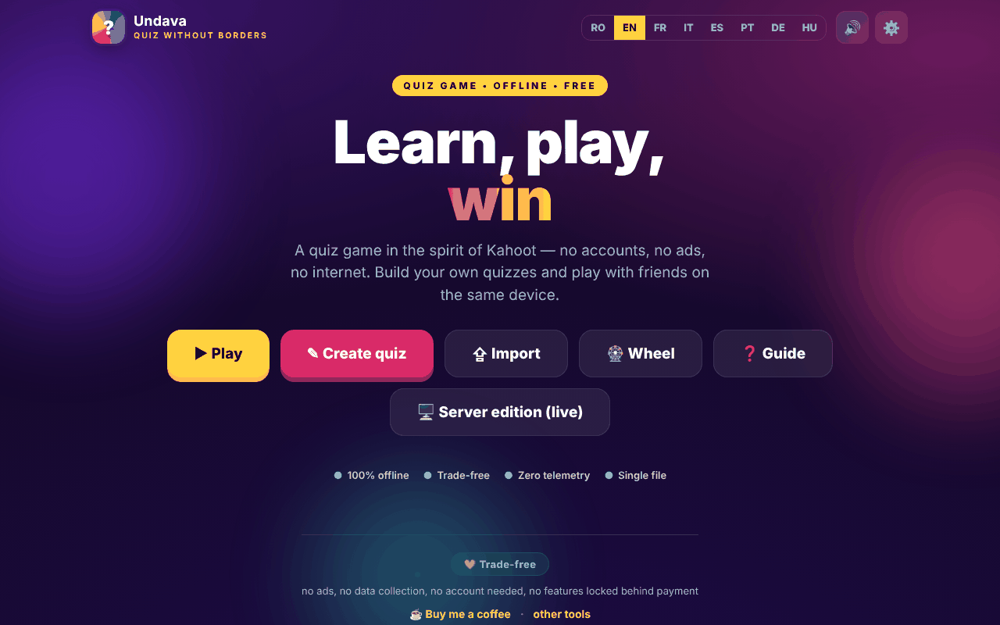

# Undava

**English** · [Română](README.ro.md) · [Français](README.fr.md) · [Italiano](README.it.md) · [Español](README.es.md) · [Português](README.pt.md) · [Deutsch](README.de.md) · [Magyar](README.hu.md)

**Version:** 2.1.0 · **Last updated:** 2026-10-27

**Status:** stable · **Offline:** complete

Interface languages: **Română, English, Français, Italiano, Español, Português (PT), Deutsch, Magyar**

A quiz game in the spirit of Kahoot — "Quiz without Borders", in a single HTML file.

**Live:** https://chiuta.github.io/Undava/

## What it is

Undava is a quiz game: you create your own quizzes and play alone or with friends on the same device. The app describes itself as "offline, free, no accounts, no ads, no telemetry". The interface is in 8 languages. The repository also contains `index.php`, a server edition (file-based storage, no SQL database), described in the file header and in the in-app manual; the page on GitHub Pages is the static edition `index.html`.

## Features

- **Play:** a quiz library (with demo quizzes), search and sorting (Default, Name A-Z, No. of questions), **Solo** and **Turn-based** game modes (several players on the same device), shuffling of questions and options, a review of the answers at the end.
- **Personal best** per quiz (Solo mode): the best score is saved locally and appears on the quiz card; at the end "New record!" appears when you beat it, and the **Retry mistakes** button replays only the questions you got wrong (without changing the record).
- **Create:** a quiz editor with title and description, four question types — Multiple choice (4 options), True / False, Free answer (with accepted variants), Numeric (with tolerance) —, Standard or Double scoring, time per question, question duplication.
- **Import / Export** quizzes as JSON files ("Export", "Save all", "Import"), printing.
- **Wheel of fortune:** a random picker from names or options (Spin, Shuffle, Reset, the option to remove the winner).
- In-app usage guide (Quick guide, User manual, Administrator manual).
- Settings: language, sound.
- The synchronous live game features, the standalone theme and the audience activities are described in the in-app manual as belonging to the server edition (`index.php`), not to the static page.
- Languages: Romanian, English, French, Italian, Spanish, Portuguese, German, Hungarian.
- **Presenter mode (2.1.0):** the 📺 button in the game bar (also in Settings, and the `P` key during a game) enlarges the question, answers, timer, results, scoreboard and podium for a projector or TV, and asks the browser for full screen (if it refuses, only the larger layout applies). The choice is remembered. It is meant for the host device of a game with the other players on one screen or on their phones (live game); the scaling applies only on windows at least 900 px wide.
- **Import from CSV (2.1.0):** "Import" accepts a `.csv` file or pasted CSV, with the **same columns as Fabrica** (`tip;întrebare;corect;greșit1;greșit2;greșit3;explicație`; delimiter `,` `;` or tab; RFC 4180 quoting; UTF-8 BOM accepted), plus a downloadable template. Recognised types: `unic` (multiple choice), `adevarat-fals`, `scurt` (variants separated by `|`) and `numeric` (the `greșit1` column is the tolerance). Rows of other types (multi, fill-in, ordering, matching) and incomplete rows are skipped and counted in the message. The file name becomes the quiz title; the usual limits apply (100 questions, text lengths). **Fabrica** can also export JSON directly for Undava ("Quiz for Undava"), which the existing JSON import reads; this version does not read Fabrica's `.course.json` itself.
- **Demo bank in Romanian (2.1.0):** four more demo quizzes ("DEMO · RO", 31 questions: Romania - geography, Romania - history, Romanian literature, science and nature) with explanations for some answers. They exist **only in Romanian** (a note appears in the library for the other interface languages). **The questions were written by an AI assistant and have not been checked by a teacher or an editor: verify them before serious educational use.**
- **Fix:** in play, the transparent container of the donation button covered the top bar and made ✕ (quit) unclickable with the mouse; now only the donation link itself receives clicks. (On very narrow screens the yellow button can still sit over the top bar.)
- **Not changed:** the server edition `index.php` is a separate copy (version 1.0.1) and does not get these features.

## User guide

1. Open the page; choose the language from the settings or from the language switch.
2. Press **Create quiz**, give it a title, press "Add question", choose the type, write the answers, tick "Correct" and press "Save quiz".
3. Press **Play**, choose a quiz and a mode (**Solo** or **Turn-based**; in Turn-based mode add the players with "+ Add player"), then "Start".
4. For questions with options you can answer by click/tap or from the keyboard: `1`–`4` or `Q`, `W`, `E`, `R`. For free-answer/numeric questions you type in the "Answer…" field.
5. At the end you can see the "Review" with the correct answers.
6. **Export** saves a quiz to a JSON file; "Save all" exports all of them; **Import** loads a JSON file (at most 50 quizzes from one file are accepted on import).
7. **Wheel**: write one item per line, press "Spin".
8. Press **Guide** for the full manual.

## Privacy and network

- **Local storage:** `localStorage`, key `undava.quiz_v1` (your quizzes, language, sound setting etc.), `undava.quiz_v1_spin` (the Wheel's items) and `undava.quiz_v1_best` (personal bests). If you clear the site data, local quizzes are lost; use the JSON export.
- **Network:** the page loads no scripts, fonts or images from other sites (CSP: `default-src 'self'`, `connect-src 'self'`). The only `fetch` in the code goes to `index.php?asset=manifest` on the same site, used when you open the "server edition"; on a static host that does not run PHP this check fails and the app shows an installation guide.
- The Open Graph meta tags point to images on `chiuta.github.io` for link previews; they are read by the platforms that display the link, not by the app.
- The `index.php` edition (if you host it) has its own server, administrator password and feedback file; it is not part of the static page.
- Note on the `index.php` edition: it **stores data on the server** (quizzes, visitor feedback in `data/feedback.txt`: optional name, rating, message, quiz), so the slogan "no telemetry" applies to what the app sends to third parties, not to the data your server receives. The feedback form of the server edition shows (in the 8 languages) a privacy note: the data is kept on the instance's server and can be read by the administrator, and deletion is requested from the administrator. If you host the server edition publicly you are the data operator (GDPR): inform visitors, delete on request (the delete button on the feedback screen or the `data/feedback.txt` file) and do not keep messages longer than necessary.
- **Installing the server edition (setup key):** "the first visitor becomes administrator" is no longer possible. Creating the first password requires a *setup key* that exists only on the server: a `setup.key` file next to `index.php` (or `../undava-setup.key`, outside the web root, safer) with at least 12 random characters, or the environment variable `UNDAVA_SETUP_KEY`. Without a key, setup is refused; a `setup.key` in the application directory is deleted automatically after setup. The key is entered in the "Administrator setup" window. Wrong attempts are slowed down per IP.

## Running locally / offline

Download `index.html` and open it in a browser; the static edition works without internet. The server edition requires PHP 7.4+ and a writable `data` directory, as per the header of `index.php`.

## License

MIT — see the LICENSE file

## Trademarks

Kahoot! is a trademark of its holder; Undava is not affiliated with Kahoot! and the name is used only descriptively ("in the spirit of…"). Other trade names mentioned belong to their holders.

## Author

Alexio — Alexandru-Ionuț Chiuță, contact: alexio@trom.tf

## Summary

Undava ("Quiz without borders") is a Kahoot-style quiz game in one HTML file: create quizzes with four question types, play Solo or pass-and-play, import/export JSON, and use a random wheel. 8-language UI. Quizzes are kept in localStorage; the static page makes no third-party requests. A separate PHP server edition (`index.php`) in the repo adds the features that need a server.

## Audit

Audit: 2026-10-10 (round 2: 2026-10-11, setup key for the initial administrator, GDPR note for feedback, accessible names in the feedback form) — verified in the browser (no JS errors, axe WCAG 2.1 AA on all screens — home, library, editor, game, wheel, guide, import, settings — 0 serious/critical problems after fixing the editor labels, the contrast and the guide's table of contents); `index.php` passes `php -l`, and the same fixes are applied in the PHP edition too.

## History / Changelog

### 2.1.0 — 2026-10-27
- Presenter mode (large text and full screen; button, setting and `P` key).
- Import from CSV with the same columns as Fabrica, with a template; four demo quizzes in Romanian (31 questions, AI-written, unreviewed).
- Fix: the donation container no longer blocks clicks on the game bar.
- Texts in 8 languages (fr/it/es/pt/de/hu are automatic, not natively verified). Test: `tests/v21.test.mjs` (60 checks).

### 2.0.0 — 2026-10-26

- **Local live game, no server** (new mode in game setup): this device is the host and players join from their phones with a QR/text code (WebRTC, the kit's `p2p` module). The host shows the question and leaderboard; phones show the choices and each player's result; scoring (speed + streak) is computed by the host. Works on the same network, for small groups (~12); large classes still use the server edition. IP addresses are visible between connected devices.
- Fix: in "Pass & play" with two or more players, the scoreboard no longer blocked moving on to the next question.

### 1.2.7 — 2026-10-23
- Robustness: corrupted locally saved quizzes (null entries, no questions, wrong types) are validated at start-up with the same rules as on import, instead of breaking the library.

### 1.2.6 — 2026-10-23

- Local storage keys now use the `undava.` prefix (`FFF.store.migrate` at startup, before any read): existing data is kept automatically, and old `.fff.json` backups can still be imported.

### 1.2.4 — 2026-10-22
- fff-kit 1.1.4: touch targets and minimum text size

### 1.2.3 — 2026-10-22
- fff-kit 1.1.2: PBKDF2 600,000 iterations, anti-clickjacking protection.

### 1.2.2 — 2026-10-22
- The native confirm() boxes (leave the editor with unsaved changes, delete a quiz, quit a game) were replaced by an accessible dialog in the current language.
- Exactly one H1: the print view of a quiz uses an H2 with the same look.
- Mobile: no text below 12 px and touch targets of at least 24 px (WCAG 2.5.8).

- 1.1.0 — 2026-10-14: Data backup and labelling (fff-kit).

- 1.0.1 — 2026-10-12: the version and the date of the last update are shown in the app
- **11 October 2026** (round 7) — hash-based SHA-256 `script-src` instead of `'unsafe-inline'`; the "Undava" logo (Home), the "← back" links and the sound switch can now be reached with Tab and activated with Enter/Space (before, they were not keyboard-accessible); Escape closes modal windows; tested (0 errors/CSP, axe 0 violations at 1280×800 and 360×740). `index.php` (the server edition) was not modified.
- **11 October 2026** — personal bests per quiz in Solo mode, "Retry mistakes" button at the end (texts in the 7 languages); tested in the browser (0 JS errors, axe-core 0 violations at 1280×800 and 360×740).
- **11 October 2026** — verification round: re-verified in the browser (no JS errors, axe-core 0 violations at 1280×800 and 360×740, no horizontal overflow); no code changes were needed in `index.html`. The app has no version number.
