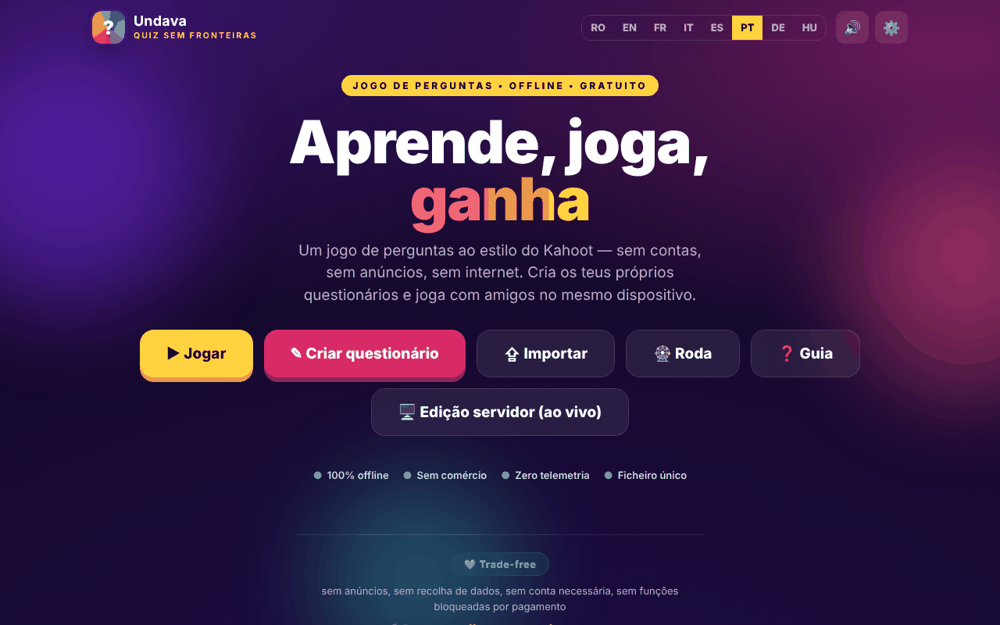

# Undava

[English](README.md) · [Română](README.ro.md) · [Français](README.fr.md) · [Italiano](README.it.md) · [Español](README.es.md) · **Português** · [Deutsch](README.de.md) · [Magyar](README.hu.md)

**Versão:** 1.2.5 · **Última atualização:** 2026-10-23

Idiomas da interface: **Română, English, Français, Italiano, Español, Português (PT), Deutsch, Magyar**

Um jogo de perguntas e respostas ao estilo do Kahoot — «Quiz sem fronteiras», num único ficheiro HTML.

**Online:** https://chiuta.github.io/Undava/

## O que é

O Undava é um jogo de quiz: crias os teus próprios quizzes e jogas sozinho ou com amigos no mesmo dispositivo. A aplicação descreve-se como «offline, gratuita, sem contas, sem anúncios, sem telemetria». A interface está em 8 línguas. O repositório contém também `index.php`, uma edição de servidor (armazenamento em ficheiros, sem base de dados SQL), descrita no cabeçalho do ficheiro e no manual da aplicação; a página no GitHub Pages é a edição estática `index.html`.

## Funcionalidades

- **Jogar:** biblioteca de quizzes (com quizzes de demonstração), pesquisa e ordenação (Predefinição, Nome A-Z, N.º de perguntas), modos de jogo **Solo** e **À vez** (vários jogadores no mesmo dispositivo), mistura das perguntas e das opções, revisão das respostas no fim.
- **Recorde pessoal** por quiz (modo Solo): a melhor pontuação é guardada localmente e aparece no cartão do quiz; no fim aparece «Novo recorde!» quando o superas, e o botão **Repetir os erros** repõe apenas as perguntas em que erraste (sem alterar o recorde).
- **Criar:** editor de quizzes com título e descrição, quatro tipos de perguntas — Escolha múltipla (4 opções), Verdadeiro / Falso, Resposta livre (com variantes aceites), Numérica (com tolerância) —, pontuação Padrão ou Dupla, duração por pergunta, duplicação de perguntas.
- **Importar / Exportar** quizzes como ficheiros JSON («Exportar», «Guardar todos», «Importar»), impressão.
- **Roda da sorte:** seletor aleatório entre nomes ou opções (Girar, Misturar, Repor, opção de eliminar o vencedor).
- Guia de utilização na aplicação (Guia rápido, Manual do utilizador, Manual do administrador).
- Definições: língua, som.
- As funcionalidades de jogo em direto síncrono, o tema autónomo e as atividades para o público são descritas no manual da aplicação como pertencentes à edição de servidor (`index.php`), e não à página estática.
- Línguas: romeno, inglês, francês, italiano, espanhol, português, alemão, húngaro.

## Manual de utilização

1. Abre a página; escolhe a língua nas definições ou no seletor de língua.
2. Prime **Criar quiz**, dá-lhe um título, prime «Adicionar pergunta», escolhe o tipo, escreve as respostas, assinala «Correta» e prime «Guardar quiz».
3. Prime **Jogar**, escolhe um quiz e um modo (**Solo** ou **À vez**; no modo À vez adiciona os jogadores com «+ Adicionar jogador»), e depois «Start».
4. Nas perguntas com opções podes responder com clique/toque ou pelo teclado: `1`–`4` ou `Q`, `W`, `E`, `R`. Nas perguntas de resposta livre/numérica escreves no campo «Resposta…».
5. No fim podes ver a «Revisão» com as respostas corretas.
6. **Exportar** guarda um quiz num ficheiro JSON; «Guardar todos» exporta-os todos; **Importar** carrega um ficheiro JSON (na importação são aceites no máximo 50 quizzes de um ficheiro).
7. **Roda**: escreve um elemento por linha, prime «Girar».
8. Prime **Guia** para o manual completo.

## Privacidade e rede

- **Armazenamento local:** `localStorage`, chave `quizfarafrontiere_v1` (os teus quizzes, a língua, a definição de som, etc.), `quizfarafrontiere_v1_spin` (os elementos da Roda) e `quizfarafrontiere_v1_best` (os recordes pessoais). Se apagares os dados do sítio, os quizzes locais perdem-se; usa a exportação JSON.
- **Rede:** a página não carrega scripts, tipos de letra nem imagens de outros sítios (CSP: `default-src 'self'`, `connect-src 'self'`). O único `fetch` no código é para `index.php?asset=manifest` no mesmo sítio, usado quando abres a «edição de servidor»; num alojamento estático que não executa PHP esta verificação falha e a aplicação apresenta um guia de instalação.
- As meta etiquetas Open Graph apontam para imagens em `chiuta.github.io` para a pré-visualização da ligação; são lidas pelas plataformas que apresentam a ligação, não pela aplicação.
- A edição `index.php` (se a alojares) tem o seu próprio servidor, palavra-passe de administrador e ficheiro de comentários; não faz parte da página estática.
- Atenção à edição `index.php`: ela **armazena dados no servidor** (quizzes, comentários dos visitantes em `data/feedback.txt`: nome opcional, classificação, mensagem, quiz), pelo que o slogan «sem telemetria» se aplica ao que a aplicação envia a terceiros, e não aos dados que o teu servidor recebe. O formulário de comentários da edição de servidor apresenta (nas 8 línguas) uma nota de privacidade: os dados são mantidos no servidor da instância e podem ser lidos pelo administrador, e a eliminação pede-se ao administrador. Se alojares publicamente a edição de servidor és o responsável pelo tratamento dos dados (RGPD): informa os visitantes, elimina a pedido (o botão de eliminar no ecrã de comentários ou o ficheiro `data/feedback.txt`) e não guardes as mensagens mais tempo do que o necessário.
- **Instalação da edição de servidor (chave de instalação):** «o primeiro visitante torna-se administrador» já não é possível. A criação da primeira palavra-passe exige uma *chave de instalação* que existe apenas no servidor: o ficheiro `setup.key` junto de `index.php` (ou `../undava-setup.key`, fora da raiz web, mais seguro) com pelo menos 12 carateres aleatórios, ou a variável de ambiente `UNDAVA_SETUP_KEY`. Sem chave, a configuração é recusada; um `setup.key` na pasta da aplicação é eliminado automaticamente após a configuração. A chave introduz-se na janela «Configuração do administrador». As tentativas erradas são abrandadas por IP.

## Execução local / offline

Transfere `index.html` e abre-o num navegador; a edição estática funciona sem internet. A edição de servidor requer PHP 7.4+ e uma pasta `data` com permissão de escrita, conforme o cabeçalho de `index.php`.

## Licença

MIT — ver o ficheiro LICENSE

## Marcas

Kahoot! é uma marca do seu titular; o Undava não é afiliado ao Kahoot! e o nome é usado apenas de forma descritiva («ao estilo de…»). Os restantes nomes comerciais mencionados pertencem aos respetivos titulares.

## Autor

Alexio — Alexandru-Ionuț Chiuță, contacto: alexio@trom.tf

## Resumo

O Undava («Quiz sem fronteiras») é um jogo de quiz ao estilo do Kahoot num único ficheiro HTML: cria quizzes com quatro tipos de perguntas, joga a Solo ou à vez, importa/exporta JSON e usa uma roda aleatória. Interface em 8 línguas. Os quizzes ficam guardados em localStorage; a página estática não faz pedidos a terceiros. Uma edição de servidor PHP separada (`index.php`) no repositório acrescenta as funcionalidades que precisam de um servidor.

## Auditoria

Auditoria: 2026-10-10 (ronda 2: 2026-10-11, chave de instalação para o administrador inicial, nota RGPD para os comentários, nomes acessíveis no formulário de comentários) — verificado no navegador (sem erros de JS, axe WCAG 2.1 AA em todos os ecrãs — início, biblioteca, editor, jogo, roda, guia, importação, definições — 0 problemas serious/critical após a correção das etiquetas do editor, do contraste e do índice do guia); `index.php` passa `php -l`, e as mesmas correções são aplicadas também na edição PHP.

## Histórico / Changelog

### 1.2.4 — 2026-10-22
- fff-kit 1.1.4: alvos táteis e texto mínimo

### 1.2.3 — 2026-10-22
- fff-kit 1.1.2: PBKDF2 com 600.000 iterações, proteção anti-clickjacking.

### 1.2.2 — 2026-10-22
- As caixas confirm() nativas (sair do editor com alterações não guardadas, eliminar um questionário, abandonar um jogo) foram substituídas por um diálogo acessível no idioma atual.
- Um único H1: a vista de impressão de um questionário usa um H2 com o mesmo aspeto.
- Telemóvel: nenhum texto abaixo de 12 px e áreas táteis de pelo menos 24 px (WCAG 2.5.8).

- 1.1.0 — 2026-10-14: cópia de segurança e etiquetagem de dados (fff-kit).

- 1.0.1 — 2026-10-12: a versão e a data da última atualização são apresentadas na aplicação
- **11 de outubro de 2026** (ronda 7) — `script-src` baseado em hash SHA-256 em vez de `'unsafe-inline'`; o logótipo «Undava» (Início), as ligações «← voltar» e o interruptor de som podem agora ser alcançados com Tab e ativados com Enter/Espaço (antes não eram acessíveis pelo teclado); Escape fecha as janelas modais; testado (0 erros/CSP, axe 0 violações a 1280×800 e 360×740). `index.php` (a edição de servidor) não foi modificado.
- **11 de outubro de 2026** — recordes pessoais por quiz no modo Solo, botão «Repetir os erros» no fim (textos nas 7 línguas); testado no navegador (0 erros de JS, axe-core 0 violações a 1280×800 e 360×740).
- **11 de outubro de 2026** — ronda de verificação: reverificado no navegador (sem erros de JS, axe-core 0 violações a 1280×800 e 360×740, sem transbordo horizontal); não foram necessárias alterações de código em `index.html`. A aplicação não tem número de versão.
